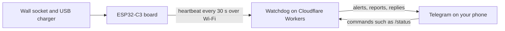

# Grid Heartbeat

A small plug-in device that tells you on Telegram when the power or the internet at home goes out.

An ESP32-C3 board on an ordinary USB charger calls a watchdog in the cloud every 30 seconds.
When the calls stop, the watchdog messages you. When they resume, it tells you whether the
power was lost or only the internet dropped. No soldering, no server to maintain, and it runs
on free plans.



The alert has to come from outside the house: in a power cut the device and the router are
both dead, so nothing at home can tell you. The device only says "I'm alive"; the watchdog
notices the silence.

## What you get on your phone

| Situation | Message |
|---|---|
| No heartbeat for the alert time (2 minutes by default) | 🔴 home went silent. Power or internet at that location is probably down. |
| Still silent an hour later (repeats hourly) | 🔴 home is still silent. Down for 1 h 2 min. |
| Back, and the device had rebooted from a power-on | 🟢 home is back after 25 min of silence. Power was lost… |
| Back, and the device never lost power | 🟢 home is back after 25 min of silence. Power stayed on… so the network or internet was down. |
| Power blinked for a few seconds | ⚡ home restarted (power-on event). Power was briefly lost. |
| Every Monday 09:00 | ✅ Weekly check-in: online, outages in the last 7 days, Wi-Fi signal |
| The 1st of each month | 📊 October: 2 outages, 1 h 48 min of silence in total (1 power, 1 network). |
| Wi-Fi signal poor for 30 minutes | 📶 home has had a weak Wi-Fi signal… |

During an outage the watchdog cannot tell a power cut from an internet outage, because both
look like silence. It tells you which one it was when the device comes back.

## Talking to the bot

Send these to your bot in Telegram. It answers only in your own chat.

| Command | What it does |
|---|---|
| `/status` | Whether the device is alive right now, how long it has run, and its Wi-Fi signal |
| `/history` | The last ten outages with start time, length and cause, plus this month's total |
| `/mute 2h` | Pauses alerts, for example while you work on the electrics (`30m`, `2h`, `1d`, up to 7 days) |
| `/unmute` | Turns alerts back on |
| `/restarts off` | Stops the ⚡ messages about brief restarts. They are still recorded. `/restarts on` brings them back |

Outages that happen while alerts are paused are still recorded. If the device is still silent
when the pause ends, you are told then. If the weekly check-in stops arriving, the watchdog
itself has a problem.

## What you need

- **A Seeed XIAO ESP32-C3 board**, the version without soldered pin headers, with its stick-on
  antenna. Other ESP32-C3 boards work with the same firmware.
- **A USB-C cable that carries data** and any 5 V USB phone charger.
- **A free Cloudflare account and a Telegram account.**
- **A computer for the one-time setup**, with Node.js 22.12 or newer and Python 3.12, 3.13 or 3.14.
  On a Mac with Homebrew: `brew install node python@3.13`.
- **2.4 GHz Wi-Fi** with WPA2 or WPA3 at the socket you want to watch. The board does not use 5 GHz.

The board costs about €6. Running it uses roughly half a watt, about 6 kWh a year at the wall.

## Setup

### 1. Create the Telegram bot

1. In Telegram, open **@BotFather**, send `/newbot` and follow the prompts. Keep the token it gives you.
2. Open your new bot, press Start, and send it any message.
3. Open `https://api.telegram.org/bot<TOKEN>/getUpdates` in a browser, replacing `<TOKEN>`
   (angle brackets included) with your token. The number after `"chat":{"id":` is your chat ID.

### 2. Publish the watchdog

Log in to Cloudflare once, then run the helper:

```bash
cd watchdog
npm install
npx wrangler login
cd ..
node setup.mjs
```

The first run creates `my-settings.txt` and opens it. Fill in the bot token, the chat ID and
your Wi-Fi name and password, save, and run `node setup.mjs` again. It then:

- publishes the watchdog and finds its address,
- creates the passwords the device needs,
- stores everything on the watchdog and sends a test message to your Telegram,
- switches on the bot commands,
- writes `firmware/secrets.yaml` for the board.

Run it again whenever you change the settings file or anything in `watchdog/`.

### 3. Flash the board

If the board has an external antenna, press its connector onto the board until it clicks
before anything else. Without it the board hears no Wi-Fi at all.

```bash
cd firmware
python3 -m venv ~/esphome-venv
source ~/esphome-venv/bin/activate
pip install esphome
esphome run heartbeat.yaml
```

Connect the board by USB when it asks where to upload, and choose the entry called
"USB JTAG/serial debug unit". The first build downloads a compiler and takes 10 to 20 minutes.
Within a minute of the board joining Wi-Fi you get "✅ home is online. Monitoring started."

### 4. Prove it works

Move the board to its charger in the socket you want to watch. Unplug it: after the alert time
you get the 🔴 alert. Plug it back in: you get 🟢 with "Power was lost". Do this once before
trusting it.

<details>
<summary>Setting up the watchdog by hand, without the helper</summary>

```bash
cd watchdog
npm install
npx wrangler login
npx wrangler deploy
```

`deploy` prints the watchdog's address. Store the secrets; each command asks for a value.
`DEVICE_TOKEN` and `TELEGRAM_WEBHOOK_SECRET` are long random strings you make up
(`openssl rand -hex 24` generates one), and `TIMEZONE` is a zone name such as `Europe/Amsterdam`.

```bash
npx wrangler secret put DEVICE_TOKEN
npx wrangler secret put TELEGRAM_BOT_TOKEN
npx wrangler secret put TELEGRAM_CHAT_ID
npx wrangler secret put TELEGRAM_WEBHOOK_SECRET
npx wrangler secret put TIMEZONE
```

Check Telegram, then tell Telegram where to send the messages you type to the bot:

```bash
curl -X POST https://grid-heartbeat.YOUR-SUBDOMAIN.workers.dev/test -H "Authorization: Bearer YOUR-DEVICE-TOKEN"
curl "https://api.telegram.org/bot<TOKEN>/setWebhook" -d "url=https://grid-heartbeat.YOUR-SUBDOMAIN.workers.dev/telegram" -d "secret_token=YOUR-WEBHOOK-SECRET"
```

Finally copy `firmware/secrets.example.yaml` to `firmware/secrets.yaml` and fill it in.

</details>

## Tuning

- **How fast it alerts:** `TIMEOUT_SECONDS` in `watchdog/wrangler.jsonc` (default 120). A short
  time alerts sooner, but a router that needs 90 seconds to restart then turns every power
  blink into an alert. 900 (15 minutes) is a calm setting. Keep it at least 3 to 4 times the
  device's `heartbeat_interval` in `firmware/heartbeat.yaml`.
- **Reminders:** `REMINDER_MINUTES` (default 60, `0` to turn off).
- **Time zone for reports:** the helper uses your computer's zone. To choose another, add a line
  such as `TIMEZONE=Europe/Istanbul` to `my-settings.txt`.
- **More devices:** flash another board with a different last part in `heartbeat_url`
  (`/hb/cabin`, `/hb/freezer`). Each is tracked and alerted separately.
- **Retiring a device** so it stops alerting:
  `curl -X DELETE https://…/devices/NAME -H "Authorization: Bearer DEVICE-TOKEN"`

After changing `wrangler.jsonc` or `my-settings.txt`, run `node setup.mjs` again.

## Troubleshooting

| What you see | What it means |
|---|---|
| `getUpdates` shows `{"ok":true,"result":[]}` | The bot has no message yet. Press Start in your own bot, send "hi", reload. |
| `getUpdates` shows `404 Not Found` | The address is malformed: angle brackets left in, `bot` missing before the token, or part of the token cut off. |
| The test prints `unauthorized` | The secrets are not stored on the watchdog. Run `node setup.mjs`. |
| The board's log repeats `No networks found` | The board hears no Wi-Fi at all. On a XIAO, the antenna is not attached or not clicked in. |
| The board finds other networks but not yours | Your router's 2.4 GHz band is off, or the Wi-Fi name in `my-settings.txt` is not exact. |
| The board cannot join and you cannot reflash | It opens a hotspot called "grid-heartbeat setup". Join it (the password is `SETUP_HOTSPOT_PASSWORD` in `my-settings.txt`) and pick your Wi-Fi there. |
| The computer does not find the board | Use a cable that carries data. Hold the BOOT button while plugging the board in. |
| ⚡ restart messages without a power cut | Multi-port chargers cut power briefly when another device is plugged in. Use a charger of its own, or send `/restarts off`. |

## Test without hardware

A pretend device on your computer sends real heartbeats to your watchdog, so you can test the
watchdog and Telegram before the board arrives:

```bash
cd watchdog
node sim/device.mjs https://grid-heartbeat.YOUR-SUBDOMAIN.workers.dev/hb/sim-test YOUR-DEVICE-TOKEN
```

Type `p` and Enter to cut or restore its power, `i` and Enter for its internet, `q` and Enter
to quit. Quitting removes `sim-test` from the watchdog so it does not keep alerting.

The decision logic has its own tests, which run against a fake clock:

```bash
cd watchdog
npm test
```

## Printed case

`case/` holds a snap-shut case for the board and its antenna: 71 × 30 × 11 mm, two parts, no
screws and no supports. Print `pulse-case-base.stl` and `pulse-case-lid.stl` as they are, in
PLA or PETG at 0.2 mm layers. The lid file is already flipped so its top face prints on the bed.

The case has been checked on the computer only and has not been printed yet. It is sized for
the XIAO ESP32-C3 without pin headers and the 40 × 20 mm stick-on antenna. Print the base
first and test the board in it. If the lid is too tight or too loose, change `LID_FIT` or
`SNAP` at the top of `case/make_case.py` and regenerate the files:

```bash
pip install manifold3d numpy
python case/make_case.py
```

## How it is put together

```
firmware/heartbeat.yaml     the board's firmware, an ESPHome configuration
watchdog/src/index.ts       the Cloudflare Worker: web routes, storage, Telegram delivery
watchdog/src/monitor.ts     when to alert and what to say
watchdog/src/reports.ts     check-ins, summaries and command replies
watchdog/src/time.ts        durations and local time
watchdog/test/              tests for the three files above
watchdog/sim/device.mjs     the pretend device
case/                       the printable case and the script that generates it
setup.mjs                   the setup helper
```

- **Firmware.** [ESPHome](https://esphome.io) supplies Wi-Fi reconnects, a setup hotspot,
  over-the-air updates and certificate-checked HTTPS. With each heartbeat the board sends a
  random number chosen at boot and the reason for its last reset. That is how the watchdog
  tells a reboot from a network gap.
- **Watchdog.** One Durable Object stores device state and outage history, and sets an alarm
  for the next moment something is due. Alerts sit in a stored outbox until Telegram accepts
  them, so an alert that fails to send is retried every 30 seconds.
- **Any HTTP client can be a device**, which is handy for watching a server or a Raspberry Pi:
  `curl -X POST https://…/hb/NAME -H "Authorization: Bearer DEVICE-TOKEN"`

A device calling every 30 seconds makes about 2,900 requests a day. Cloudflare's free plan
allowed 100,000 a day when this was written.

## Keeping secrets out of the repository

`my-settings.txt` and `firmware/secrets.yaml` hold your tokens and your Wi-Fi password. Both
are listed in `.gitignore`, so git leaves them out. Do not add them by hand, and do not upload
the folder through GitHub's website, which ignores those rules.

## Limits to know about

- Silence means "power or internet"; you learn which only on recovery. To know during the
  outage, the device and router would need battery backup, or the device a cellular modem.
- The device reports only its latest restart. If power returns but the Wi-Fi stays away for
  more than 15 minutes, ESPHome restarts the device and the recovery message will say
  "probably not a power cut".
- If Cloudflare or Telegram have an outage at the same moment, alerts are delayed until they recover.
- Telegram notifications are easy to miss on a silenced phone. Give the bot's chat a distinct,
  loud notification sound.

## A single plug-in box later (custom PCB)

A board plus a phone charger does the job and keeps you away from mains wiring: the charger
is the certified, isolated part. A custom PCB only buys a tidier single enclosure, and costs
more than the ready-made board unless you build hundreds. If you want one anyway, this is the
outline to design from. It is not a finished or reviewed design.

- **Mains input:** plug pins or a screw terminal, then a 250 VAC slow-blow fuse (0.5-1 A),
  then a 275 VAC varistor across live and neutral.
- **Power:** a safety-certified, encapsulated AC-DC module with a 3.3 V output of 2 W or more
  (for example Mean Well IRM-03-3.3). Do not build a capacitive-dropper or other non-isolated supply.
- **Low-voltage side:** 100 µF or more of bulk capacitance on 3.3 V, an ESP32-C3-MINI-1 module
  with its usual EN pull-up and capacitor, a boot button on GPIO9, a status LED, and a USB-C
  connector on GPIO18/19 (or a 4-pin serial header) for the first flash.
- **Layout:** at least 6.5 mm between anything mains-connected and anything low-voltage, no
  copper in that gap, and ideally a slot milled through it. Keep the antenna end of the module
  at the board edge, away from the power module.
- **Enclosure:** fully closed, flame-rated plastic, with no way to touch the board while it is plugged in.

Have someone experienced with mains designs review the schematic and layout before you power it.
